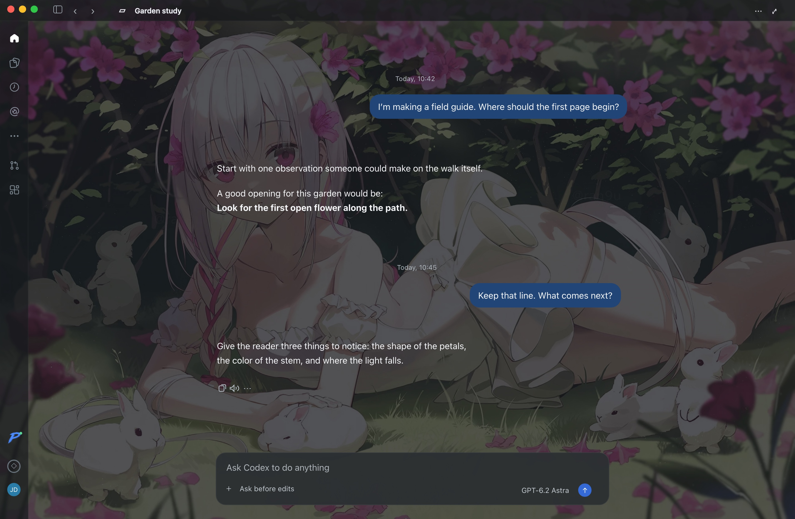
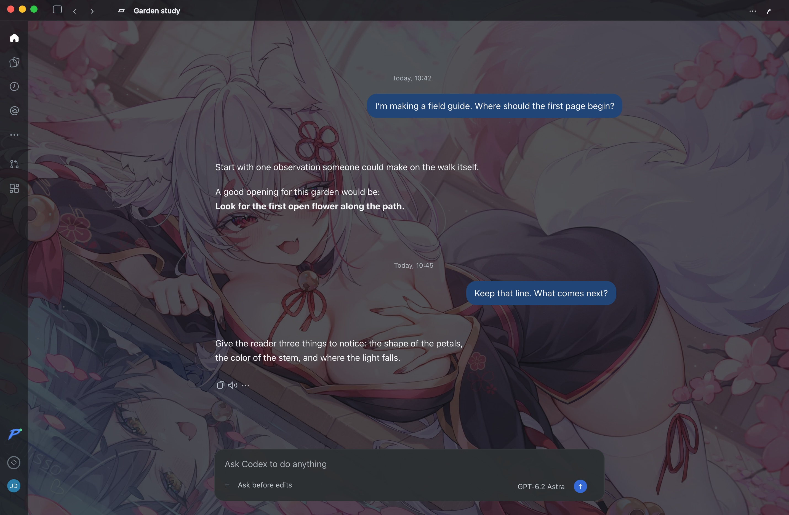

# 自定义背景

为 Codex 设置透明背景、内置图片或本地图片，并在 Codex 设置的“自定义背景”页面中管理显示效果。

## 壁纸效果

同一段对话切换背景后的效果，点图可查看原尺寸。

| 花园与白兔 | 粉色花枝 |
| --- | --- |
|  |  |

## 功能

- 可选择无背景、透明背景、内置图片或本地文件。历史记录和收藏中的旧链接图片仍可使用。
- 透明背景可继续使用颜色遮罩、界面控件磨砂和窗口底层磨砂
- 保存当前背景及最近使用记录
- 收藏会把原图下载到 `~/Pictures/Packpier/收藏`。取消星标会保留已下载的文件。旧收藏在插件启动时依次补存。
- 在收藏或最近使用中右键图片可复制到 macOS 剪贴板，或保存原图到 `~/Downloads`。
- 背景图磨砂和界面控件磨砂可独立调节，控件磨砂默认关闭。
- 预览下方可随机切换内置图片。P-Sign 也可以换图或打开背景设置。

## 安装

在 Packpier「插件市场」选择 Codex，打开内置的「自定义背景」查看版本和权限。启用后，通过 Codex 设置或左下角的 P 打开背景设置。

## 权限与安全

- Renderer：修改 Codex 页面背景和设置界面，并在浏览器本地存储中保存背景配置
- Node：代理远程图片请求、解析重定向并读取需要保存的远程图片内容
- 网络：访问历史记录中已保存的图片地址，以及内置图片服务 `t.alcy.cc` 和 `tc.alcy.cc`

## 兼容性

- Packpier 的 Codex 适配器 v3
- 已测试平台：macOS
- 兼容 `data-theme` 与旧版 `electron-light` 主题标记
- 设置页通过 `ui.settingsSections@1` 挂载。从 Codex 设置与 P-Sign 均可打开同一页面
- 开启控件磨砂后，输入框、侧栏、窗口边框和固定工具面板使用半透明磨砂；聊天记录中的卡片保留半透明底色，减少长会话滚动时的重复模糊开销
- 已知限制：依赖 Codex 当前页面结构；内置图片功能依赖第三方图片服务可用性

## 开发

运行 `mise run install` 安装锁定依赖，使用 `mise run check` 检查语法、`mise run test` 运行现有逻辑测试。在 Packpier 中导入并编译更新后的插件包；验证主题切换、设置面板、启用、停用和 Node 授权流程时使用真实页面。

## 致谢

感谢 [LINUX DO](https://linux.do/) 社区为开发者提供交流与分享的空间。

## 许可证

本项目使用 [MIT 许可证](LICENSE)。
