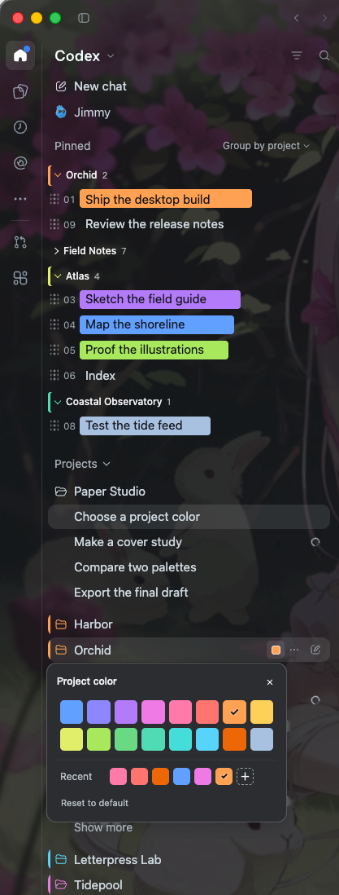

# Prism

[简体中文](#简体中文) · [English](#english)

## 简体中文

Prism 给 Codex 左栏的项目和会话配色。它沿用 Codex 的置顶顺序，可在「置顶」里切换整体排序和按项目聚合。

| 操作 | 可以看到的效果 |
| --- | --- |
| 给会话选色 | 指针移到会话行，点右侧色块，选择颜色。会话标题出现色条，同一会话在「置顶」「项目」「最近」中使用同一个颜色。 |
| 给项目选色 | 指针移到项目行，点右侧色块。项目文件夹及行首标记采用选定颜色。会话选择「继承项目色」后会随项目变色。 |
| 查看置顶顺序 | 展开「置顶」查看编号。切到按项目聚合，可以只展开某个项目，查看其中的置顶会话。 |
| 撤销配色 | 在对应行的色板里点「恢复默认色」。也可以从「最近使用」选回以前用过的颜色。 |

## English

Prism adds project and conversation colors to the Codex sidebar. It follows the native pinned order and lets you group pinned chats by project.

| Action | Result |
| --- | --- |
| Color a conversation | Hover over its row, click the swatch on the right and pick a color. The title gains a color strip. The same conversation uses that color under Pinned, Projects and Recent. |
| Color a project | Use the swatch on the project row to change the folder color and leading marker. Choose **Inherit project color** on a conversation to make it follow that project. |
| Inspect pinned order | Expand Pinned to see the rank numbers. Switch to project grouping to expand just one project's pinned conversations. |
| Reset a color | Open the row's palette and choose **Restore default color**. Choose a swatch from Recently Used to apply a previous color again. |

Packpier keeps your Prism preferences on this Mac. The plugin reads the local Codex catalog to match conversations to projects. [View the sidebar and project palette](https://raw.githubusercontent.com/JFireworm/packpier/main/docs/images/prism-sidebar.png)
