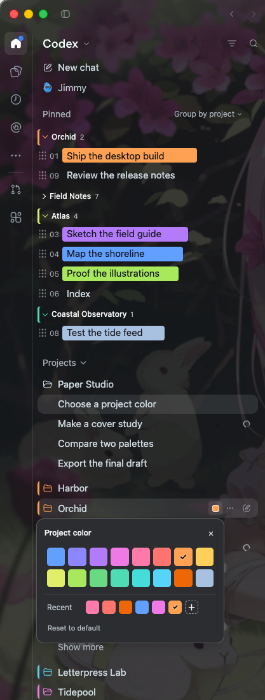
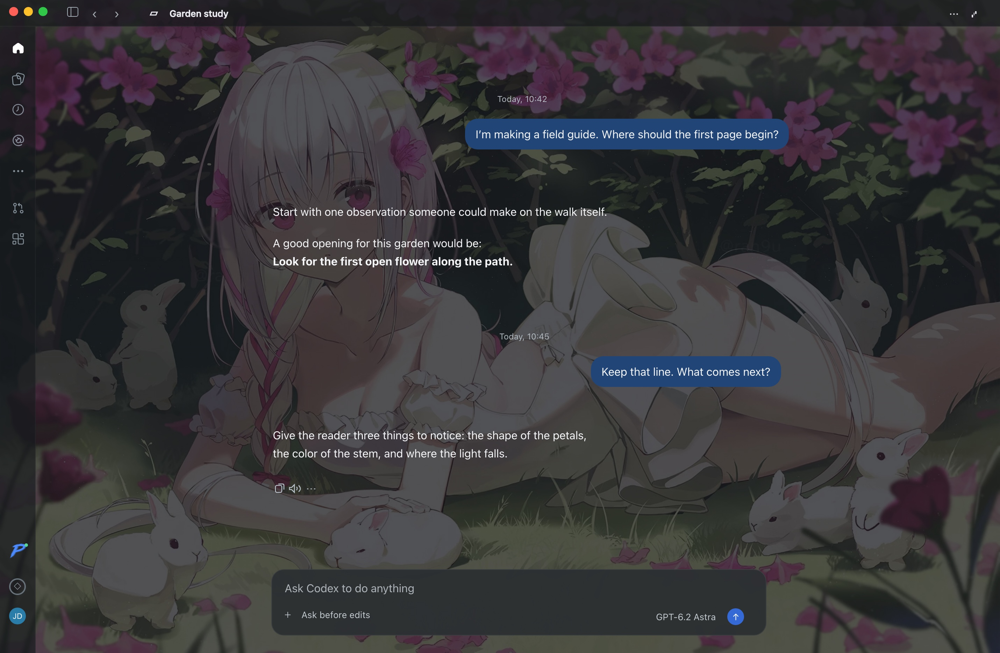
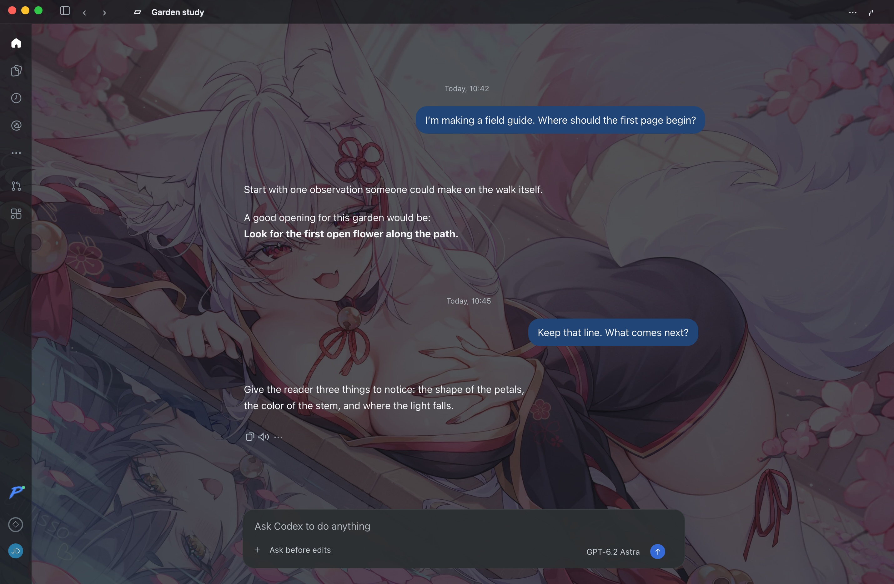

# Packpier

[简体中文](README.md) · **English**

Packpier is a macOS plugin manager for Codex. The marketplace shows where each plugin appears, how it looks and whether it is running. Codex is the supported app. Support for additional apps is in development.

| Built-in plugin | What it does in Codex |
| --- | --- |
| P-Sign | Hover over the P with the small green dot in the bottom-left corner. Click the picture icon to change the wallpaper or the sliders to open background settings. |
| Prism | Color a conversation consistently across Pinned, Projects and Recent. Group pinned chats by project or give a chat its own color. [Prism guide and examples](Plugins/Prism/README.md#english) |
| Custom Background | Choose a local file or a built-in image, adjust the tint and blur, and pick a wallpaper again from Favorites or Recently Used. Open Settings → Custom Background. |

### Prism

Pinned chats are grouped by project. A color strip marks each colored chat, and the swatch on a project row opens its palette.

<a href="docs/images/prism-sidebar.png"></a>

### Custom Background

The same conversation with two different wallpapers. Select either image to see it at full size.

| Garden and rabbits | Pink blossoms |
| --- | --- |
| [](docs/images/background-garden.jpg) | [](docs/images/background-blossoms.jpg) |

### Install

1. Open [GitHub Releases](https://github.com/JFireworm/packpier/releases/latest) and choose the file for your Mac. Apple Silicon uses arm64. Packpier requires macOS 14 or later.
2. Open the DMG and **drag Packpier.app onto Applications in the same window**. Eject the disk image and open Packpier from Applications. For the v0.1.23 ZIP, extract the app and drag it to Applications.
3. In the marketplace, green means a plugin is running in a Codex window, an empty circle means waiting and red indicates a plugin error. Select a plugin to read its installation details and error message.

Starting with 0.1.24, Packpier includes a Node.js runtime with SQLite support. Version 0.1.23 uses a system runtime. If Prism reports `No such built-in module: node:sqlite`, use a build with the bundled runtime or provide a compatible Node.js installation for the older release. [Node.js SQLite version history](https://nodejs.org/api/sqlite.html)

If Codex is running but Packpier cannot find a local connection, it has found the process and is still waiting for a usable window connection. A plugin dependency error can occur at the same time. After copying the app to Applications, open Packpier to start the bundled loader. In Connection Details, “Plugin loader: Responding” confirms that the app has received a reply from its helper. The Codex window row reports the window connection separately. Each plugin also shows its own enable switch and runtime status.

### Plugins and data

The three built-ins are protected from removal. The marketplace supports importing, reordering and storing local plugin ZIPs. The release loads the three bundled effects in the Codex window. Prism stores its colors locally. Custom Background fetches built-in images over the network and can save favorites in your Pictures directory. [Plugin authoring Skill](Resources/Skills/packpier-plugin-author/SKILL.md)

### Build, test and update

Install Xcode, Node.js 22.13+, npm, Python 3, uv and Chrome on macOS. The first build verifies the downloaded Sparkle framework and Node.js runtime. Set `CHROME_BIN` to select another Chrome executable for tests.

```sh
make bootstrap
make check
open build/Packpier.app
./Scripts/build-dmg.sh
```

`make lint` checks source and distribution files. `make unit` and `make integration` run the test suites. Plugin sources are in [Prism](Plugins/Prism), [Custom Background](Plugins/CustomBackground) and [P-Sign](Resources/BundledPlugins/p-sign). Regenerate their marketplace archives with `python3 Scripts/plugin-archives.py` after editing a plugin.

Select **Check for Updates** in Settings & Updates. Maintainers run `python3 Scripts/release.py` after building and attach the installer DMG, Sparkle update ZIP and signed `appcast.xml` to the corresponding GitHub Release. Set `PACKPIER_SIGNING_ACCOUNT` to select a release key in the macOS Keychain. Apple Developer ID signing and notarization are separate release steps. [MIT license](LICENSE) · [Third-party notices](THIRD_PARTY_NOTICES.md)
