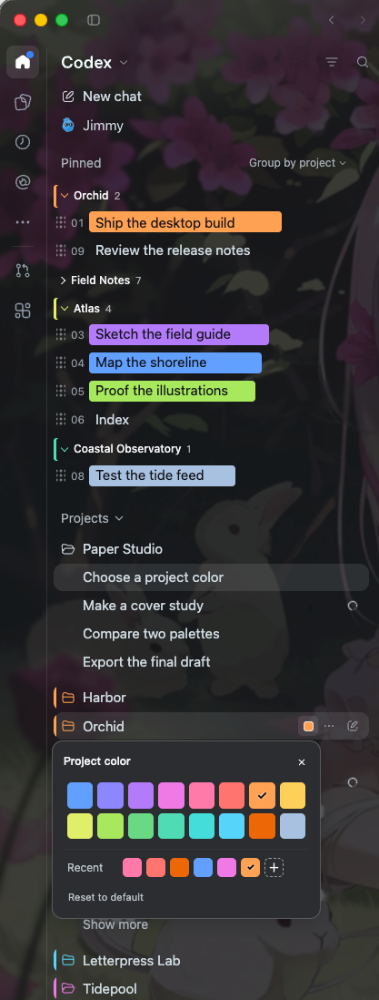

# Packpier

[简体中文](README.zh-CN.md) · **English**

Packpier is a native macOS plugin manager for the Codex desktop app. It installs, orders, enables and removes plugins, and mounts their effects directly in a running Codex window. Packpier 0.1.30 uses a Swift host and native services, so the three built-in plugins work without installing Node.js.

## Built-in plugins

| Plugin | What it does in Codex |
| --- | --- |
| **P-Sign** | Puts a P with a small status dot in the bottom-left corner. Hover it for wallpaper and background-settings shortcuts. |
| **Prism** | Colors a conversation consistently across Pinned, Projects and Recent. Group pinned chats by project or give one chat its own color. |
| **Custom Background** | Uses a local file or a built-in image, adjusts tint and blur, and restores wallpapers from Favorites or Recently Used. |

### Prism

Pinned chats can be grouped by project. A color strip marks each colored chat, and the swatch on a project row opens its palette. Saved chat and project colors also appear in custom sections.

<a href="docs/images/prism-sections.png"></a>

### Custom Background

The same conversation with two wallpapers. Select an image to open it at full size.

| Garden and rabbits | Pink blossoms |
| --- | --- |
| [](docs/images/background-garden.jpg) | [](docs/images/background-blossoms.jpg) |

## Install

Packpier requires macOS 14 or later. Choose the DMG matching **About This Mac**. Apple M-series chips use the `macOS-arm64.dmg` asset. Intel Macs use the `macOS-x86_64.dmg` asset.

1. Open [GitHub Releases](https://github.com/JFireworm/packpier/releases/latest) and download the DMG for your Mac.
2. Open the DMG and **drag Packpier.app onto Applications in the same window**. Eject the disk image, then open Packpier from Applications.
3. In the marketplace, green means the plugin is running in a Codex window, an empty circle means waiting and red means the plugin reported an error. Select a plugin for its version, permissions and error message.

The current build is ad-hoc signed and **not notarized by Apple**. If macOS blocks the first launch, confirm the file came from this project's GitHub Releases, then open **System Settings → Privacy & Security** and choose **Open Anyway**.

On first launch Packpier registers itself as a login item. If macOS asks for approval, open **Settings & Updates → Open Login Items Settings**. Automatic updates are on by default on Apple Silicon and can be changed on the same screen. Intel users update by downloading the new x86_64 DMG from Releases.

## Connect to Codex

Packpier mounts plugins through Codex's own loopback DevTools endpoint (`127.0.0.1:9335`). It never edits the Codex app bundle or its configuration.

- **Codex not running:** Packpier launches it with the required local debugging arguments.
- **Codex already running without that endpoint:** save your work in Codex, then click **Restart and connect** next to the marketplace status. Packpier asks Codex to quit; if it has not exited after 5 seconds it is force-quit, then reopened with the local endpoint. **Unsaved Codex sessions may be lost**, which is why Packpier asks for confirmation first.
- **You started Codex from the Dock afterwards:** the endpoint is missing again. Use **Restart and connect** once more.

If the window still does not connect, open **Connection Details → Show Log File in Finder**. Packpier writes loader startup and Codex connection checks to `~/Library/Logs/Packpier/connection.log`.

## Third-party plugins

The marketplace imports local plugin ZIPs, reorders them and stores them per user. Plugins can declare a renderer entry (`packpier.entrypoints.renderer`) and, optionally, a Node backend (`packpier.entrypoints.node`).

- Renderer-only packages use Packpier's built-in window host; no Node.js is needed.
- A package with a Node backend needs **system Node.js 22 or later**. Review the package, then choose **Allow this version**. Packpier starts one process per enabled, approved backend and stops it when the plugin is disabled. Changing the package contents requires approval again.
- The three built-in effects are the only plugins Packpier injects into Codex today; other packaged effects are managed and shown in the marketplace but not mounted.

## Data and privacy

- Plugin order, switches and per-plugin settings live in `~/Library/Application Support/Packpier`.
- Prism stores colors locally. Custom Background fetches its built-in images over the network and saves favorites under `~/Pictures/Packpier/收藏`.
- Packpier does not require an account and does not upload plugin data.

## Build and test

You need Xcode, Node.js 22.13+, npm, Python 3, uv and Chrome. The build uses Node.js only for JavaScript tooling and verifies the downloaded Sparkle framework. Set `CHROME_BIN` to use another Chrome executable for the page tests.

```sh
make bootstrap
make check
open build/Packpier.app
./Scripts/build-dmg.sh
```

To cross-build the Intel edition on Apple Silicon after `make bootstrap`:

```sh
PACKPIER_ARCH=x86_64 ./Scripts/build.sh
PACKPIER_ARCH=x86_64 ./Scripts/build-dmg.sh
```

The Intel App is staged in `build/x86_64/Packpier.app`. The disk image is `build/Packpier-0.1.30-macOS-x86_64.dmg`. This build uses the same Sparkle framework. The current release feed serves an arm64 update ZIP. Maintainers can enable an Intel-compatible signed feed with `PACKPIER_FEED_URL` and `PACKPIER_PUBLIC_ED_KEY`.

Packpier 0.1.30 includes a **Windows x64 preview**. It opens the shared read-only plugin marketplace and shows plugin versions and descriptions. Codex integration, plugin installation and enablement are available on macOS. See the [Windows run instructions](Windows/README.md) and [porting plan](docs/windows-port.md).

`make lint` checks source and distribution files. `make unit` and `make integration` run the test suites. Plugin sources live in [Prism](Plugins/Prism), [Custom Background](Plugins/CustomBackground) and [P-Sign](Resources/BundledPlugins/p-sign). After editing a plugin, run `python3 Scripts/plugin-archives.py` to refresh its marketplace archive.

## Release and updates

Packpier uses Sparkle 2. Maintainers run `python3 Scripts/release.py` after building; it creates the update ZIP, signs `appcast.xml` with the release key in the macOS Keychain and prepares the assets for the matching GitHub Release. Set `PACKPIER_SIGNING_ACCOUNT` to select another keychain entry. Apple Developer ID signing, notarization and publishing the release itself are separate steps.

## License

[MIT](LICENSE) · [Third-party notices](THIRD_PARTY_NOTICES.md) · [Plugin authoring Skill](Resources/Skills/packpier-plugin-author/SKILL.md)
