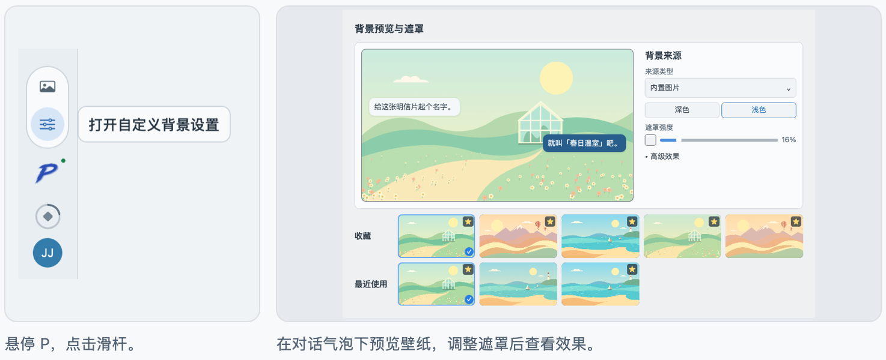

# Packpier

Packpier 是 macOS 上的插件管理器。在「插件市场」选择目标应用，点选插件即可查看效果示例、安装详情和运行状态。界面支持简体中文、English、日本語和 한국어。

0.1.23（34）使用 Packpier 自研加载器，可直接在真实 Codex 窗口挂载 P-Sign、Prism 和自定义背景。窗口增强通过 Codex 自身的本机调试端口完成，不修改 Codex 的应用文件；退出 Packpier 后，注入的界面元素和事件监听会被清理。Prism 与自定义背景的 Node 服务需要本机安装 Node.js 22 或更高版本。

| 应用 | 插件 | 可以做什么 |
| --- | --- | --- |
| Codex | P-Sign | 在左下角显示 P 和加载状态绿点。移入指针可换背景、打开背景设置。 |
| Codex | Prism | 为项目和会话配色，按置顶顺序查看会话。 |
| Codex | 自定义背景 | 使用本地或内置来源的图片，调节遮罩与磨砂，从收藏或最近使用中重新选图。 |
| 微信 | 青瓷 | 为 Mac 微信 3.8.7（28249）的会话列表添加淡绿色层，需辅助功能权限。 |



### 开始使用

打开 Packpier 后，在插件市场选择 Codex。P-Sign、Prism 和自定义背景是受保护的内置插件。选择插件可以查看该版本的权限说明。可导入本地 ZIP 查看、排序和保存源包。真实窗口只运行随 App 编译的三个内置效果。微信需要先通过「添加应用」加入市场。[青瓷使用说明](Plugins/WeChatCeladon/README.md)

### 从源码构建

准备 macOS 14 或以上、Xcode 和 npm。将 Sparkle 2.9.6 的完整框架放在 `build/Dependencies/Sparkle.framework`，也可通过 `SPARKLE_FRAMEWORK_PATH` 指定路径。构建脚本编译 `Loader/` 中的 Swift 源码，生成三个内置窗口效果的模块，签名应用后核对包内加载器与编译产物，并输出其 SHA-256。[Sparkle 发布页](https://github.com/sparkle-project/Sparkle/releases/tag/2.9.6)

```sh
./Scripts/build.sh
open build/Packpier.app
```

### 窗口加载器

加载器由 Swift 管理的插件库和 `Loader/WindowHost` 中的 Node 宿主组成。宿主读取 Codex 在本机 `127.0.0.1:9335` 暴露的调试端点，只选择 `app://-/index.html` 主窗口，注入 `window-effects.js`，并通过 CDP 绑定把页面里的 `snapshot`、`network.request` 等调用转发给插件包内的 Node 入口。Codex 退出或重新载入页面后，宿主会重新连接并挂载。

打开 Codex 设置，在「外观」下方选择「自定义背景」。从 P-Sign 打开时，若设置窗口未打开，会显示独立面板。加载器会依次尝试 `PACKPIER_NODE`、`/opt/homebrew/bin/node`、`/usr/local/bin/node` 和 `~/.nvm` 下的最新版本；找不到 Node.js 时，插件管理仍可用，窗口效果保持等待。

### 插件权限

自研加载器按用户保存的顺序和开关选择 P-Sign、Prism、自定义背景。插件库可以保留其他插件的记录。

自定义背景的内置图片来源会联网取图，收藏可写入用户的图片目录。Prism 在本机读取项目及会话归属并保存颜色。青瓷使用 macOS 辅助功能定位微信窗口。

### 开发与验证

| 路径 | 内容 |
| --- | --- |
| `Sources/`、`Tests/` | macOS 主程序、适配器和集成检查 |
| `Plugins/Prism/`、`Plugins/CustomBackground/` | Prism 与自定义背景的可读源码 |
| `Resources/BundledPlugins/p-sign/` | P-Sign 的可读源码 |
| `Plugins/WeChatCeladon/` | 青瓷的 Swift 包及测试 |
| `Resources/Marketplace/` | 插件目录、效果预览与构建实际使用的 ZIP |

自定义插件可从随应用提供的开发 Skill 开始。修改内置 Codex 插件时，需要同步更新对应的市场 ZIP。Prism 及 P-Sign 的清单在 ZIP 根目录，自定义背景的清单在 ZIP 内的 `custom-background/` 目录。版本号须与市场目录中的记录一致。[插件开发 Skill](Resources/Skills/packpier-plugin-author/SKILL.md)

在 macOS 上安装 Xcode、Node.js 22、Python 3、uv 和 Chrome。以下命令可从干净检出运行。设置 `CHROME_BIN` 可指定测试浏览器。

```sh
make bootstrap
make check
```

`make lint` 检查 JS、Swift、Python、Shell 和分发资源。`make unit` 覆盖原生界面逻辑、背景与青瓷。`make integration` 通过独立插件库、私有协议与临时浏览器配置验证导入、导出、删除、排序、背景设置和窗口效果。重新生成插件归档使用 `python3 Scripts/plugin-archives.py`。

### 下载与更新

在「设置与更新」点「检查更新」。Sparkle 从 GitHub Releases 读取 appcast，比较构建号，提供安装已签名新版的按钮。自动更新偏好控制后台检查与下载。[项目主页](https://github.com/JFireworm/packpier) · [下载发行版](https://github.com/JFireworm/packpier/releases/latest)

维护者构建后运行 `python3 Scripts/release.py`，使用专用钥匙串条目为 ZIP 和更新清单签名。可用 `PACKPIER_SIGNING_ACCOUNT` 指定已有的签名条目。将输出的 ZIP 和 `appcast.xml` 同时附在版本对应的 GitHub Release，再发布为 Latest。其他维护者可在本地构建中用 `PACKPIER_FEED_URL` 和 `PACKPIER_PUBLIC_ED_KEY` 指定自己的更新源和公钥。[第三方声明](THIRD_PARTY_NOTICES.md)
