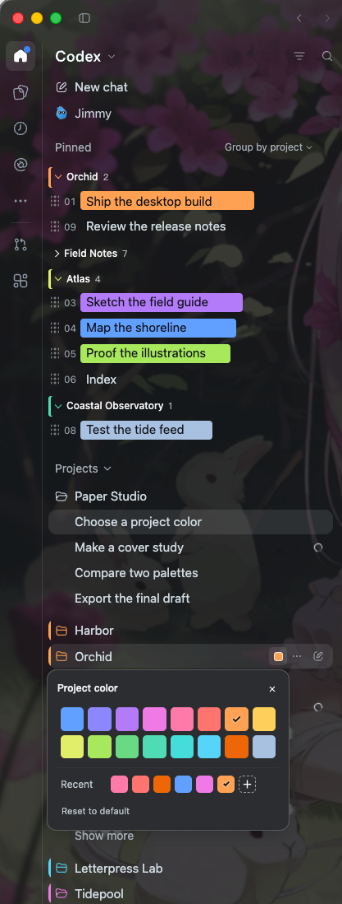
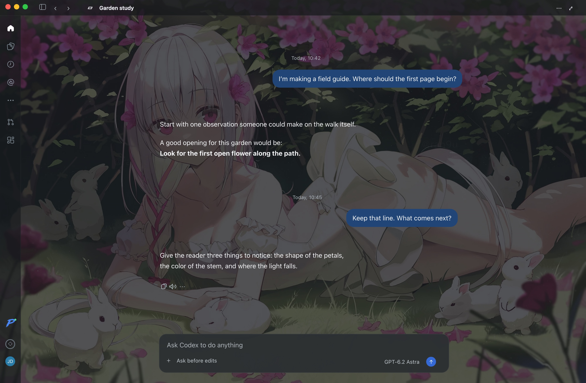

# Packpier

**简体中文** · [English](README.md)

Packpier 是 macOS 上的 Codex 插件管理器。插件市场展示每个插件在 Codex 中的位置、使用效果和运行状态。当前支持 Codex，其他目标应用的接入仍在开发中。

| 内置插件 | 在 Codex 里可以做什么 |
| --- | --- |
| P-Sign | 把指针移到左下角带小绿点的 P 上。点图片图标换背景，点滑杆打开背景设置。 |
| Prism | 在置顶、项目和最近会话中使用同一套颜色。可按项目聚合置顶会话，也可单独给一个会话选色。[查看 Prism 效果与操作](Plugins/Prism/README.md) |
| 自定义背景 | 使用本地文件或内置图片，调整遮罩和磨砂，在收藏和最近使用中重新选图。入口在「设置 → 自定义背景」。 |

### Prism

侧栏中的置顶会话按项目分组。会话标题上的色条标记单条会话，项目行右侧的色块可以打开项目色板。

<a href="docs/images/prism-sidebar.png"></a>

### 自定义背景

同一段对话切换两张壁纸后的效果，点图可查看原尺寸。

| 花园与白兔 | 粉色花枝 |
| --- | --- |
| [](docs/images/background-garden.jpg) | [](docs/images/background-blossoms.jpg) |

### 安装

1. 打开 [GitHub Releases](https://github.com/JFireworm/packpier/releases/latest)，选择适合这台 Mac 的安装文件。Apple Silicon 对应 arm64，最低系统版本为 macOS 14。
2. 下载 DMG 后双击打开，将 **Packpier.app 拖到同一窗口中的 Applications（应用程序）**。复制完成后推出磁盘映像，从「应用程序」打开 Packpier。使用 v0.1.23 的 ZIP 时，解压后将 App 拖入「应用程序」。
3. 打开插件市场。绿色表示已在 Codex 窗口中运行，空心圆表示等待，红色表示该插件报告错误。点选插件可以看到「安装详情」和错误原文。

0.1.24 起，App 随附支持 SQLite 的 Node.js 运行时。0.1.23 使用本机的 Node.js，Prism 需要可直接导入 `node:sqlite` 的版本。若旧版提示 `No such built-in module: node:sqlite`，请使用包含运行时的安装包，或为旧版准备支持该模块的 Node.js。[Node.js SQLite 版本说明](https://nodejs.org/api/sqlite.html)

「Codex 已运行，未检测到可用的本机连接」表示 Packpier 已找到 Codex 进程，窗口连接尚未建立。这个状态和 Prism 的 SQLite 错误可以同时出现。把 App 拖入「应用程序」后打开 Packpier，加载器会随主程序启动。在状态提示旁点「连接详情」；「插件加载器 · 已响应」表示主程序已收到加载器的回复，下方的「Codex 窗口」单独显示窗口连接结果。每个插件的启用开关与它是否已在窗口中运行分别显示。

首次安装后若插件一直等待，可在「连接详情」中点「打开日志文件位置」。Packpier 会在 `~/Library/Logs/Packpier/connection.log` 记录加载器启动和 Codex 本机连接的检测结果。Codex 提供可用的本机连接后，插件才能在窗口中显示。

### 插件与数据

三个内置插件受删除保护。插件市场支持导入、排序和保存本地插件 ZIP；正式版的 Codex 窗口效果由三个内置插件提供。Prism 在本机保存颜色，自定义背景的内置图片来源会联网，收藏可保存到用户的图片目录。[插件开发 Skill](Resources/Skills/packpier-plugin-author/SKILL.md)

### 构建、测试与更新

在 macOS 上安装 Xcode、Node.js 22.13+、npm、Python 3、uv 和 Chrome。首次构建会校验下载的 Sparkle 框架和 Node.js 运行时。可用 `CHROME_BIN` 指定测试浏览器。

```sh
make bootstrap
make check
open build/Packpier.app
./Scripts/build-dmg.sh
```

`make lint` 检查代码与分发资源，`make unit` 和 `make integration` 运行单元与集成测试。内置插件源码位于 [Prism](Plugins/Prism)、[自定义背景](Plugins/CustomBackground) 和 [P-Sign](Resources/BundledPlugins/p-sign)。修改插件后执行 `python3 Scripts/plugin-archives.py` 同步市场归档。

在「设置与更新」点「检查更新」即可获取新版。维护者在构建后运行 `python3 Scripts/release.py`，将安装 DMG、Sparkle 更新用的 ZIP 和签名的 `appcast.xml` 一起上传到对应版本的 Release。Sparkle 使用钥匙串里的发布密钥，`PACKPIER_SIGNING_ACCOUNT` 可指定密钥条目。Apple Developer ID 签名和公证需另行完成。[MIT 许可证](LICENSE) · [第三方声明](THIRD_PARTY_NOTICES.md)
